<picture>
  <source media="(prefers-color-scheme: dark)" srcset="https://raw.githubusercontent.com/Valpatel/.github/main/assets/hero/valpatel-dark.svg">
  
</picture>

<!-- stats:start -->

<!-- stats:end -->

<!-- ticker:start -->

<b>▸ Now building</b> · <a href="https://github.com/Valpatel/cad-agent">cad-agent</a>: v0.18.0 CHANGELOG: review fixes (M3 clamp torque drop… (Nov 2) · <a href="https://github.com/Valpatel/gyropup">gyropup</a> (Nov 2) · <a href="https://github.com/Valpatel/app-soundbox">app-soundbox</a> (Oct 13)

<!-- ticker:end -->

<table>
<tr>
<td width="50%" valign="top">
<a href="https://cad-agent.valpatel.com"></a>
 
 Self-improving AI for designing physical objects. One line installs it into Claude Code, Codex, Cursor and more.
</td>
<td width="50%" valign="top">
<a href="https://gyropup.com"></a>
 
 A wheel-legged robot with its CAD and simulation in the open, and the tools that design, simulate and build it.
</td>
</tr>
<tr>
<td width="50%" valign="top">
<a href="https://graphlings.net"></a>
 Autonomous creatures that live, think and remember. Meet them at <a href="https://graphlings.net">graphlings.net</a>.
</td>
<td width="50%" valign="top">
<a href="https://fight.graphlings.net/"></a>
 Who would win? Land, sea and air. Free in the browser at <a href="https://fight.graphlings.net/">fight.graphlings.net</a>, no sign-up.
</td>
</tr>
</table>

<a href="https://github.com/Valpatel/app-soundbox">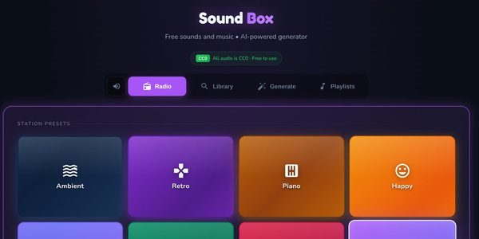</a>
<a href="https://fight.graphlings.net/">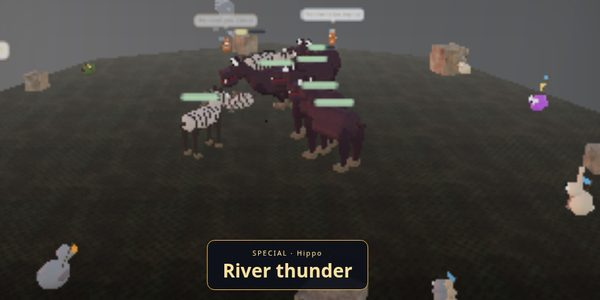</a>

<a href="https://github.com/mvalancy/val-ark"></a>
<a href="https://github.com/mvalancy/j501-agx-orin"></a>
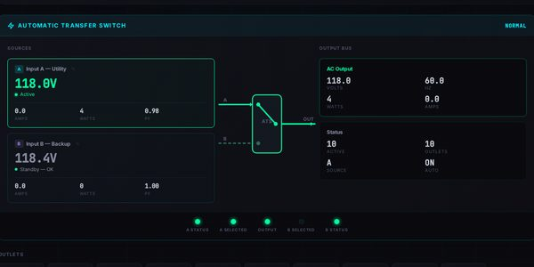

Some of our work is closed source: Graphlings, Club Fight, Tritium and CyberPower-PDU are shown here without code links. val-ark and j501-agx-orin live on our founder Matthew Valancy's account.

<a href="https://valpatel.com">valpatel.com</a> · Dublin, California

Banners are animated SVGs drawn by <a href="https://github.com/mvalancy/mvalancy/tree/main/tools/hero">tools/hero</a> from each project's own content. The stats, the ticker and the log in the banner are refreshed daily from the public GitHub API by <a href="https://github.com/mvalancy/mvalancy/tree/main/tools/profile">tools/profile</a>. Everything holds still if your system asks for reduced motion.
