<picture>
  <source media="(prefers-color-scheme: dark)" srcset="https://raw.githubusercontent.com/Valpatel/.github/main/assets/hero/valpatel-dark.svg">
  
</picture>

# Valpatel Software

**Gamify the development and management of independent thinking machines.**

We engineer systems for autonomous platforms — robotics simulation, perception, edge AI, and the infrastructure that makes it all work. Based in Dublin, California.

Build fast, explore broadly, then cut ruthlessly to what works.

> **Note —** In light of recent emergent capabilities, our projects have moved to closed source.
> Public repositories are being retired and development continues privately. Previously published
> releases remain under the terms they were issued.

**Jump to:** [Open projects](#open-projects) · [In development](#in-development) · [Graphlings](#graphlings) · [Tritium](#tritium) · [Sound Box](#sound-box) · [CyberPower PDU Bridge](#cyberpower-pdu-bridge)

---

## Open projects

<a href="https://github.com/Valpatel/gyropup"><picture><source media="(prefers-color-scheme: dark)" srcset="https://raw.githubusercontent.com/Valpatel/.github/main/assets/cards/gyropup-dark.svg"></picture></a>
<a href="https://github.com/Valpatel/cad-agent"><picture><source media="(prefers-color-scheme: dark)" srcset="https://raw.githubusercontent.com/Valpatel/.github/main/assets/cards/cad-agent-dark.svg"></picture></a>

<a href="https://github.com/Valpatel/app-soundbox"><picture><source media="(prefers-color-scheme: dark)" srcset="https://raw.githubusercontent.com/Valpatel/.github/main/assets/cards/app-soundbox-dark.svg"></picture></a>

[**Gyropup**](https://github.com/Valpatel/gyropup) — A research robot designed to balance on two wheel-legs, with a foam-ball turret: CAD and simulation in the open, and the closed-loop tooling that designs, simulates and manufactures it. [gyropup.com](https://gyropup.com)

[**cad-agent**](https://github.com/Valpatel/cad-agent) — A one-stop shop for agentic CAD: self-improving AI for designing physical objects, built with the best open-source projects. One line installs it into Claude Code, Codex, Cursor and more.

[**Sound Box**](#sound-box) — Synthetic audio generation for AI agents, and a local GenAI SoundCloud for humans.

---

## In development

<a href="https://graphlings.net"><picture><source media="(prefers-color-scheme: dark)" srcset="https://raw.githubusercontent.com/Valpatel/.github/main/assets/cards/graphlings-dark.svg"></picture></a>
<picture><source media="(prefers-color-scheme: dark)" srcset="https://raw.githubusercontent.com/Valpatel/.github/main/assets/cards/tritium-dark.svg"></picture>

<picture><source media="(prefers-color-scheme: dark)" srcset="https://raw.githubusercontent.com/Valpatel/.github/main/assets/cards/club-fight-dark.svg"></picture>
<picture><source media="(prefers-color-scheme: dark)" srcset="https://raw.githubusercontent.com/Valpatel/.github/main/assets/cards/cyberpower-pdu-dark.svg"></picture>

**Club Fight** *(private)* — An animal fighting game.

---

## 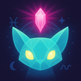 Graphlings

*[Graphlings](https://graphlings.net) — Created by Matthew Valancy, Copyright 2026 Valpatel Software LLC.*

**Persistent crystal creatures that live, think, and remember across connected worlds.**

[Graphlings](https://graphlings.net) are autonomous digital life forms — crystal creatures with personalities, memories, and motivations that develop over time in their own game universe. They aren't scripted NPCs. Each one runs on a local LLM, observes its surroundings, reasons about what to do, and acts independently. They form relationships, remember experiences, breed inherited traits, and communicate with voice.

When a simulation begins in another system (like [Tritium](#tritium)), Graphlings cross over from their home world to play roles — a defender who remembers last week's breach, an attacker with a grudge, a bystander who notices things. When the mission ends, they return home with new memories. Think of it like the TV show *ReBoot*: the simulation is a game that descends into the Graphlings' world. They suit up, play their parts, and go home when the game ends.

The system distributes Graphling cognition across your local compute fleet — desktop mini PCs, RTX workstations, NVIDIA Jetson, Mac Minis, or any Ollama-capable device on your network or Tailscale mesh. Small fast models handle background life; larger models drive critical decisions. Community ownership means your AI runs on your hardware. Self-hostable dedicated servers keep your creatures' data under your control.

Cross-platform (PC, Mac, Mobile) | Coming 2026 | [graphlings.net &rarr;](https://graphlings.net)

---

## Tritium

*Unified Operating Picture* *(private)*

**Neighborhood security is too important to be a SaaS.** Track, identify, and fuse every target — BLE, WiFi, camera, radar, SDR, LoRa mesh, acoustic — into one tactical picture on a real-world map. Runs entirely on your own hardware.

Every detected entity gets a unique target ID. A BLE scanner sees a phone. A camera sees a person. TPMS picks up tire sensors from a car. The system correlates them into one entity and builds a dossier that grows over time — daily routines, travel routes, known associates.

- **23+ sensor plugins** — BLE tracking, WiFi fingerprinting, YOLO detection, license plate recognition, acoustic classification, SDR spectrum monitoring, LoRa mesh, ATAK/CoT interoperability
- **Pluggable AI commander** — monitors the tactical picture, narrates events, dispatches assets. Runs on local LLMs via Ollama
- **Edge firmware** — Tritium-OS for ESP32-S3 with 66+ HALs (BLE, WiFi, acoustic, LoRa, power management)
- **Self-improving** — 92% accurate target correlator via reinforcement learning. 933-entry BLE device database. Autonomous development loop with local LLM monitoring
- **Battle simulation** — same sensor fusion pipeline exercised with wave-based combat, projectile physics, and AI narration

**[Graphlings](https://graphlings.net) integration:** Tritium's plugin system deploys Graphlings from their home universe into battle scenarios as intelligent NPCs — autonomous agents that observe, reason, and remember. When the battle ends, they return home with new memories.

Three components: **tritium-lib** (shared models + interfaces) | **tritium-sc** (command center) | **tritium-edge** (ESP32 firmware + fleet server)

Python 3.12 + FastAPI + vanilla JS | Proprietary

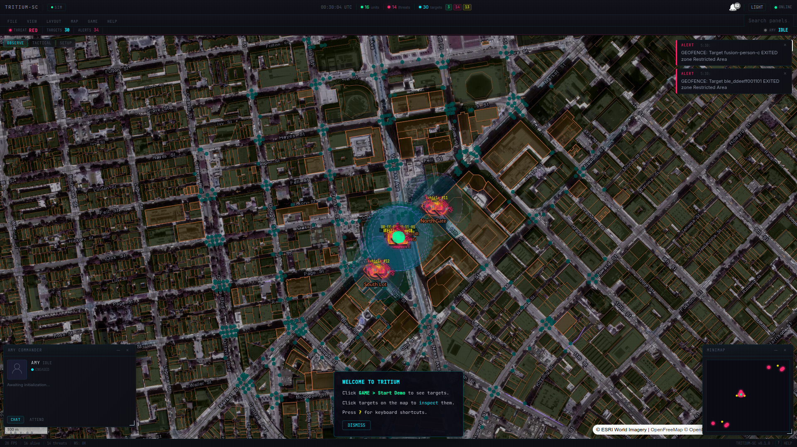

---

## Sound Box

**Synthetic audio generation for AI agents. Local GenAI SoundCloud for humans.**

A local, offline box that provides synthetic music, sound effects, and voice to any agent or app on your network. AI agents discover it automatically via MCP, generate and review assets, and pull audio programmatically — no human in the loop required. Multiple engines (MusicGen, AudioGen, MAGNeT, Piper TTS) running on local GPU. All output is CC0 public domain.

For humans, it's a full listening app — community radio stations, a searchable library, 10 real-time visualizers, voting, favorites, and fullscreen immersive mode. The UI makes it fun to browse and curate what the AI is producing.

Flask + PyTorch + SQLite FTS5 | Runs on desktop GPU, Jetson, or DGX

[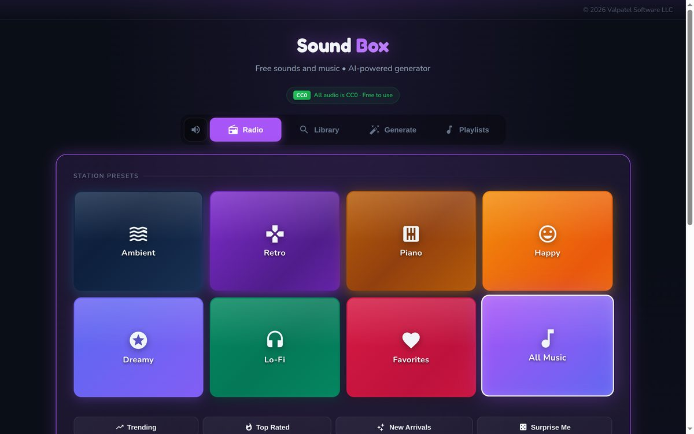](https://github.com/Valpatel/app-soundbox)

  <a href="https://github.com/Valpatel/app-soundbox">
    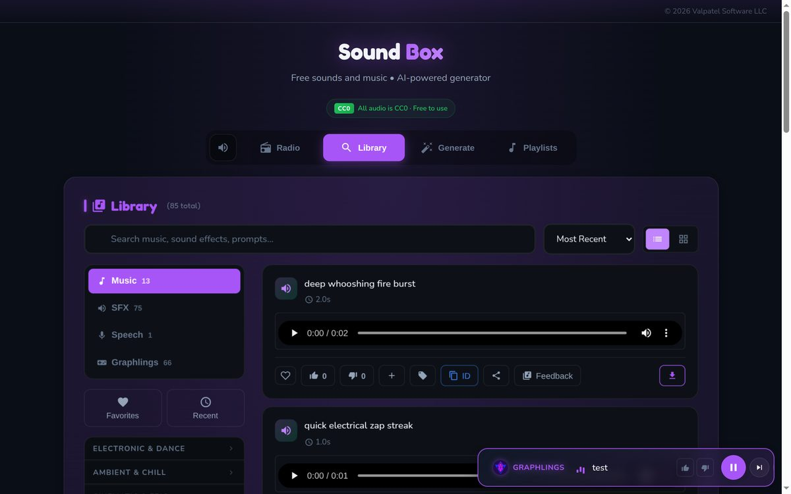
  </a>
  <a href="https://github.com/Valpatel/app-soundbox">
    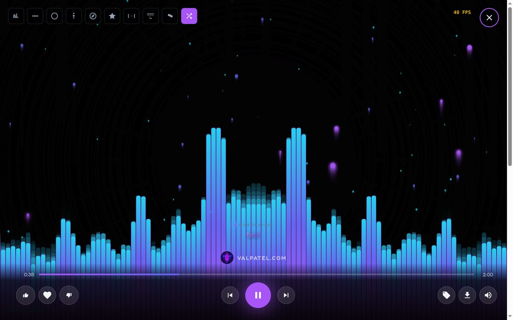
  </a>

---

## CyberPower PDU Bridge

*(private)*

**Self-hosted monitoring and automation for CyberPower power distribution units.**

Real-time web dashboard for PDUs and automatic transfer switches. Polls devices over SNMP and serial, publishes metrics to MQTT, stores 60 days of 1Hz time-series data, and integrates with Home Assistant auto-discovery. Centralized control of multiple PDUs with an in-app automation rules engine.

Python + Docker + MQTT + InfluxDB

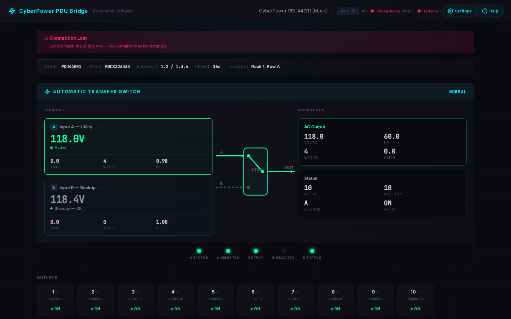

---

  <a href="https://valpatel.com">valpatel.com</a>

